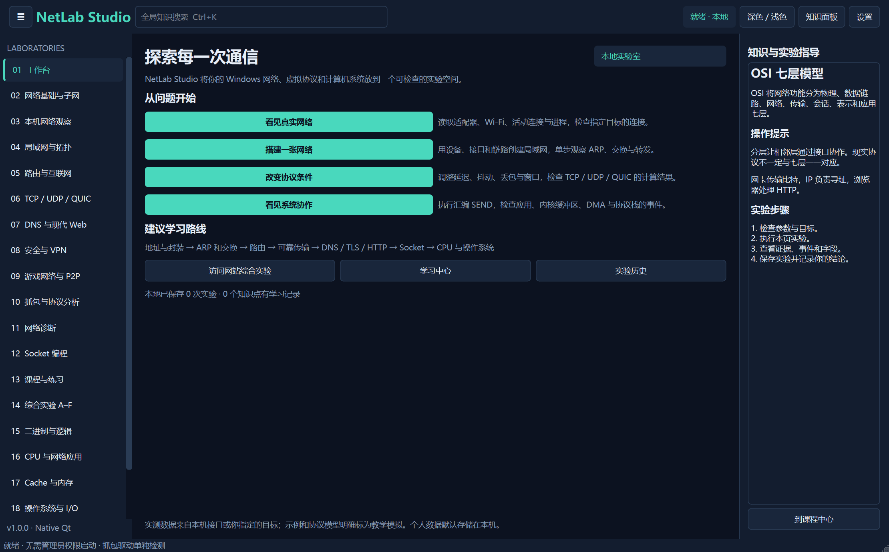
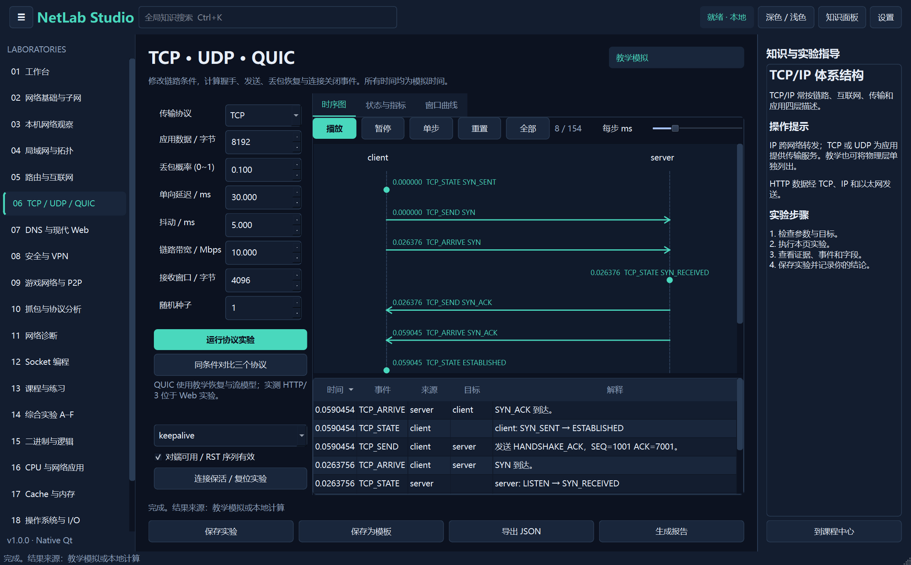

# NetLab Studio

NetLab Studio 是使用 Python 和 PySide6 开发的原生 Windows 计算机网络与计算机系统实验室。它可以读取本机网络、对明确指定的目标进行诊断、编辑虚拟拓扑、计算协议事件，并运行 CPU、Cache 和操作系统实验。界面默认中文深色主题，可切换浅色主题。

## 七日发布

从 2026-10-10 起，本仓库每天加入 NetLab Studio 1.0.0 的一部分内容，计划于 2026-10-16 完成。第七天发布完成前，默认分支里的源码尚不完整，不能作为可运行版本。

- 10-10：项目介绍、安装入口和发布资料
- 10-11：网络协议与拓扑模型
- 10-12：网络诊断和实际通信服务
- 10-13：CPU、Cache 与操作系统模型
- 10-14：界面、课程和数据存储
- 10-15：示例、构建脚本和打包配置
- 10-16：测试、验证资料和完整 1.0.0 源码



## 运行项目

在 Windows 上使用源码运行时，双击 `Setup_NetLab.cmd` 安装依赖，再双击 `Launch_NetLab.cmd` 启动。打包后，程序位于 `dist\NetLabStudio\NetLabStudio.exe`。

便携版需要保留整个 `NetLabStudio` 文件夹，不能只复制其中的 EXE。普通账户即可启动，不需要 Npcap 或管理员权限。程序不会自动发送诊断请求、修改 IP/DNS/路由或防火墙。

如果从源代码启动：

```powershell
.\.venv\Scripts\python.exe main.py
```

## 在另一台 Windows 电脑安装源代码环境

1. 从 [Python 官方网站](https://www.python.org/downloads/windows/) 安装 64 位 Python 3.13 或 3.12，保留 Python Launcher。当前项目实际验证使用 Python 3.13。
2. 将本项目放在可写目录。双击 `Setup_NetLab.cmd`，它会在项目内创建 `.venv` 并安装依赖。
3. 双击 `Launch_NetLab.cmd`。

也可以在 PowerShell 中执行：

```powershell
py -3.13 -m venv .venv
.\.venv\Scripts\python.exe -m pip install -r requirements.txt
.\.venv\Scripts\python.exe main.py
```

`requirements.txt` 给出兼容范围，`requirements-lock.txt` 记录本次构建环境的具体版本。若需要复现本次 Windows/Python 3.13 环境，可将安装参数改为 `-r requirements-lock.txt`。

## 实验入口

| 工作区 | 可以实际操作的内容 |
|---|---|
| 网络基础 | IPv4/IPv6、二进制子网过程、CIDR、VLSM、冲突检查、IPv4 分片、路径 MTU |
| 本机观察 | 网卡、地址/掩码、MAC、网关/DNS、接口计数、Wi-Fi 原始字段、路由、连接/进程、防火墙规则 |
| 局域网与拓扑 | 拖动设备、连接端口、修改配置、ARP/ND、交换/VLAN、DHCP、静态路由、NAT、STP 教学树、虚拟包分析 |
| 路由 | 最长前缀匹配、Dijkstra、Bellman-Ford、RIP/OSPF 教学计算、BGP 邻居路径传播与 AS 环路拒绝 |
| 传输层 | 可调延迟/抖动/丢包/带宽/窗口的 TCP、UDP、QUIC 教学模拟；时序、指标、拥塞窗口、保活/RST |
| DNS 与 Web | DNS/DoH/DoT、HTTP/HTTPS、实际 HTTP/3、TLS 检查、本地 HTTP/HTTPS、网站访问教学时序 |
| 安全与 VPN | 实际哈希、密钥交换、认证加密、签名与篡改实验；TLS 时序、虚拟防火墙、VPN 分流/封装 |
| 游戏网络 | NAT 直接路径/中继教学选择、位置预测/插值动画与同步误差；指定目标的延迟测试 |
| 抓包 | PCAP/PCAPNG 导入、字段/Hex、协议筛选、TCP 会话事件、流量统计；可用驱动下的有限实时抓包 |
| 诊断 | Ping、Traceroute、TCP、DNS、TLS/HTTPS、延迟/丢包/抖动和诊断向导 |
| 编程 | 可编辑、可执行的 Python/C 示例；TCP/UDP/HTTP/HTTPS/HTTP3/WebSocket/SSH 本地测试服务 |
| 课程 | 178 个知识点、针对性题目、相关内容链接、笔记、进度、错题、三种学习模式 |
| 计算机系统 | 二进制/IEEE 754/ALU、电路门连接、汇编 CPU、Cache/堆栈、进程调度、分页、DMA/缓冲区 |
| 综合实验 | A 网站、B 家庭局域网、C 游戏、D 故障挑战、E CPU 经虚拟网络收发、F 网络/CPU 性能模型 |

课程内容覆盖概念的范围比模拟器实现的协议细节更广。逐项实现层级、真实测试范围和未实现内容见 [功能及限制](docs/FEATURES.md)，不能把某个课程条目理解成完整协议栈实现。



## 第一次实验

### 家庭局域网

1. 打开“局域网与拓扑”，载入 `home` 示例。
2. 选择来源 `PC1`、目标 `PC2`，点击“发送虚拟包”，再单步或连续运行。
3. 点击设备检查 ARP 和 MAC 表。双击设备编辑接口，Ctrl 选择两台设备后连接端口。
4. 申请 DHCP 时把来源选为客户端、目标选为 `R1`。
5. 将目标改为 `WEB`，观察网关、路由和 NAT。右键关闭设备，或编辑链路的 `up`，观察运行中的故障。
6. 点击“交给协议分析”，查看根据虚拟字段编码的教学帧。这些帧没有发送到真实网卡。

### CPU 发送消息

打开“CPU 与网络应用”，默认程序在内存中写入 `Hi`。点击“CPU 消息交给虚拟网络”会重新执行编辑器中的汇编，消息将经过当前拓扑，收到虚拟回显后写入接收内存。默认使用 `PC1` 到 `WEB`，可在拓扑页改变来源和目标。若链路断开，实验会保留失败状态，并不会生成成功回复。

独立 CPU 的 `RECV` 使用明确标注的教学回环队列；综合实验中的 `RECV` 只读取实际到达的虚拟网络回复。

### 本地 HTTPS

在 Web 工作区点击“启动本地 HTTPS”，再执行请求。程序创建临时测试证书，并只对该本地服务器使用它的 CA。外部 HTTPS 使用系统信任库；程序不会跳过未知目标的证书验证。

## 代码实验

编辑器中的代码只在点击“运行代码”后执行。它是带时间和输出上限的本机子进程，不是安全沙箱；请只运行你信任的代码。示例均默认回环地址，不自动连接第三方服务器。

便携版使用随软件运行的独立 Python 练习子进程，可执行内置示例及打包包含的标准库与协议库，无需另装解释器。需要其他第三方包时，使用源码环境并安装相应依赖。C 示例需要 GCC 或 Clang；当前验证环境使用 w64devkit 的 GCC 检查了 C TCP 和 UDP 通信。源码环境的 Python 示例使用 `.venv`。C 不是应用启动的必要依赖。

示例源码在 `examples\socket`。TLS、HTTP/3、WebSocket 和 SSH 使用成熟库；网络模拟中的 QUIC 与 VPN 不代替这些库的真实实现。

## 保存与分享

默认数据位置是 `%LOCALAPPDATA%\NetLabStudio\netlab.sqlite3`。设置、学习记录、实验、拓扑、笔记和模板保存在本机；日志使用大小限制与滚动文件。

实验页可以保存结果、保存参数模板、导出 JSON 和生成可编辑 Markdown 报告。数据管理页可以导入/导出备份、导出 CSV、载入拓扑和模板、删除记录或清除个人数据。备份分享导出、CSV 和 Markdown 报告默认脱敏；实验页的原始 JSON 和拓扑/快照导出不脱敏，便于恢复完整配置。原始记录保留在本机。

脱敏用于常见结构化敏感字段及地址，不保证能识别任意正文、Hex 载荷或自定义代码中的个人信息。分享前应检查导出内容。脱敏备份的地址已被替换，因此不要使用它恢复可运行网络配置；需要恢复实验时使用原始本地备份。

## 自动化测试

```powershell
.\.venv\Scripts\python.exe -m pytest -q
```

测试包括算法、协议状态、失败/超时、数据库迁移与恢复、CPU/Cache/调度、实际回环通信、PCAP 文件及原生 Qt 基本交互。外网服务器没有被自动当作测试前提。验证记录见 [验证结果](docs/VALIDATION.md)。

无需外网的启动检查：

```powershell
.\.venv\Scripts\python.exe main.py --data-dir qa\smoke-data --quit-after 3
```

打包后可以执行回环通信、模型、存储与内置 Python 练习检查，结果写入 JSON 后自动关闭：

```powershell
.\dist\NetLabStudio\NetLabStudio.exe --verify qa\check.json --data-dir qa\check-data
```

示例 PCAP 和计算结果位于 `examples\captures` 与 `examples\experiments`，均明确标注为教学数据；`scripts\generate_examples.py` 可以重新生成。

## 打包

```powershell
.\.venv\Scripts\python.exe -m PyInstaller --noconfirm NetLabStudio.spec
```

或双击 `Build_Windows.cmd`。输出为 `dist\NetLabStudio`。该目录包含 Qt、协议库、证书根文件、示例和文档；测试数据库和 `.venv` 不进入便携程序。构建使用普通用户权限，无管理员启动清单。

`scripts\package_release.py` 会将完整便携目录与源码分别打包到 `releases`，检查 ZIP 完整性并写入 SHA-256 清单。便携包无需安装 Python 即可运行实验室与内置 Python 示例；C 编译器和额外 Python 包的要求见上面的代码实验说明。

## 文档

- [架构](docs/ARCHITECTURE.md)
- [操作指南](docs/USER_GUIDE.md)
- [功能及限制](docs/FEATURES.md)
- [验证记录](docs/VALIDATION.md)
- [依赖与参考资料](docs/DEPENDENCIES.md)

## 许可证

本仓库目前没有为 NetLab Studio 源码指定许可证。

